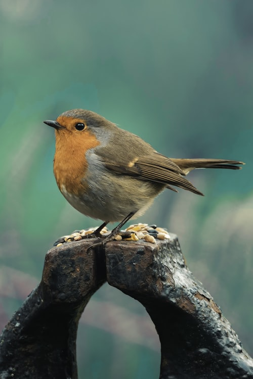
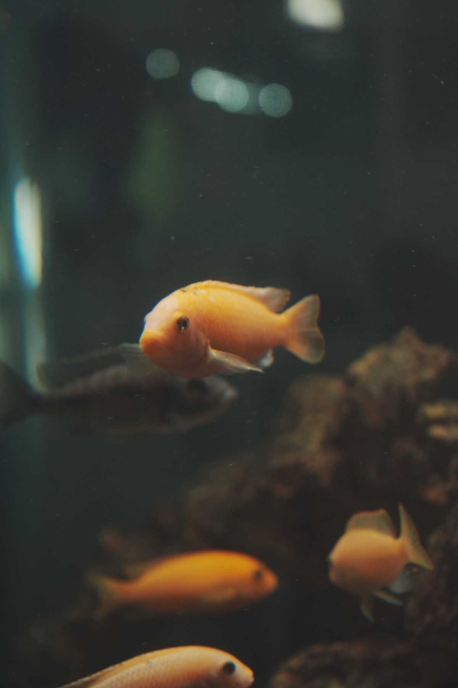

# 003 — Consolidar duración del zoom de imagen en hover a 300ms

- **Status**: DONE
- **Commit**: 8971a12
- **Severity**: LOW-MEDIUM
- **Category**: Cohesión / tokens (AUDIT.md §7)
- **Estimated scope**: 2 files, 21 class-attribute edits (find/replace exacto, no markup changes)

## Problem

El mismo gesto — imagen que hace zoom sutil (`scale-105`) al pasar el mouse sobre una card — usa tres duraciones distintas en el sitio sin ninguna razón funcional para la diferencia:

- `duration-300` — 72 ocurrencias (mayoría: cards de "ficha relacionada" dentro de las 21 páginas de especie/artículo)
- `duration-500` — 9 ocurrencias, todas en `cuidados/cuidados.html` (bento grid de especies)
- `duration-700` — 12 ocurrencias, todas en `mundo-exotico/mundo-exotico.html` (grid de artículos)

AUDIT.md §7: *"Curves and durations should live as shared tokens. Five hand-typed cubic-beziers that almost match is a consolidation finding."* Mismo problema aquí con duraciones sueltas en vez de una convención única para el mismo gesto.

Ejemplo en `cuidados/cuidados.html:84`:

```html
<!-- cuidados/cuidados.html:84 — actual -->

```

Ejemplo en `mundo-exotico/mundo-exotico.html:92`:

```html
<!-- mundo-exotico/mundo-exotico.html:92 — actual -->

```

## Target

Usar `duration-300` en los dos archivos (alineado con el valor ya mayoritario en el resto del sitio — 72 de 93 ocurrencias totales):

```html
<!-- cuidados/cuidados.html:84 — target -->

```

```html
<!-- mundo-exotico/mundo-exotico.html:92 — target -->

```

300ms también respeta el presupuesto de duración de AUDIT.md §2 para elementos de UI (bajo 300ms), mientras que 500ms y 700ms lo exceden sin ser justificados como "marketing/explicativo".

## Repo conventions to follow

- `duration-300` ya es el valor dominante para este mismo gesto en las 21 páginas de ficha/artículo (ej. `cuidados/hamster.html:217`, `:221`, `:225`, `:229`) — este plan simplemente elimina las dos excepciones.

## Steps

1. En `cuidados/cuidados.html`: reemplazar TODAS las 9 ocurrencias de la subcadena exacta `duration-500` por `duration-300`. Las 9 ocurrencias están en las líneas 84, 91, 98, 108, 115, 122, 129, 136, 143 (todas siguen el patrón `group-hover:scale-105 transition-transform duration-500`).

2. En `mundo-exotico/mundo-exotico.html`: reemplazar TODAS las 12 ocurrencias de la subcadena exacta `duration-700` por `duration-300`. Las 12 ocurrencias están en las líneas 92, 109, 126, 143, 160, 177, 194, 211, 228, 245, 262, 279 (todas siguen el patrón `transition-transform duration-700 group-hover:scale-105`).

3. Confirmar que no quedan `duration-500` ni `duration-700` en ninguno de los dos archivos:
   ```bash
   grep -n "duration-500\|duration-700" cuidados/cuidados.html mundo-exotico/mundo-exotico.html
   ```
   Debe devolver vacío.

## Boundaries

- Do NOT tocar ningún otro archivo — el resto de `cuidados/` y `mundo-exotico/` ya usa `duration-300` correctamente.
- Do NOT tocar `index.html`, `tienda/`, `tienda.html`, `nosotros.html`, `contacto.html` (aunque `index.html` también tiene `duration-500` en sus propias cards, está fuera de alcance — es del branch de Miguel).
- Do NOT cambiar `scale-105` ni el orden de las clases — solo el número de la duración.
- Si el conteo de ocurrencias no coincide con lo documentado aquí (drift desde el commit `8971a12`), STOP y reportar en vez de reemplazar a ciegas.

## Verification

- **Mecánica**:
  ```bash
  grep -c "duration-300" cuidados/cuidados.html   # debe dar 9 (antes tenía 0, ahora las 9 que eran duration-500)
  grep -c "duration-300" mundo-exotico/mundo-exotico.html   # debe dar 12
  grep -n "duration-500\|duration-700" cuidados/cuidados.html mundo-exotico/mundo-exotico.html   # vacío
  ```
- **Feel check**: abrir `cuidados/cuidados.html` y `mundo-exotico/mundo-exotico.html`, pasar el mouse sobre varias cards de cada grid.
  - El zoom debe sentirse igual de sutil, solo un poco más rápido que antes (300ms vs 500-700ms) — no debe sentirse brusco ni instantáneo.
  - Comparar mentalmente con una card de `cuidados/hamster.html` (sección "Otras fichas") — el timing del zoom debe sentirse idéntico entre ambas páginas ahora.
- **Done when**: ambos archivos usan `duration-300` en el 100% de sus zooms de imagen y ningún `duration-500`/`duration-700` queda en `cuidados/` ni `mundo-exotico/`.
